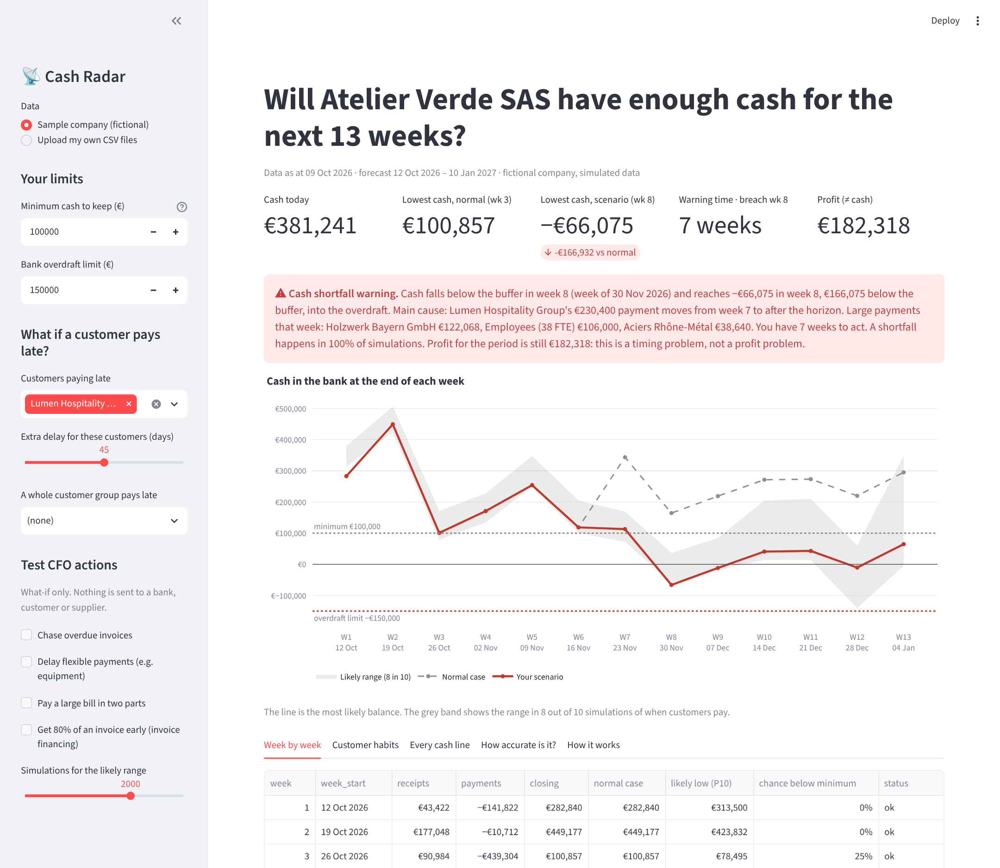
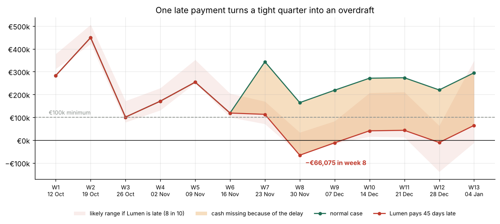
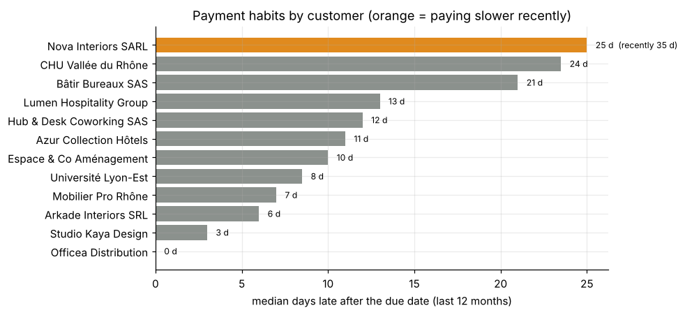

# 📡 Cash Radar — spotting a cash shortage before it happens

**A 13-week cash forecast that warns a finance manager weeks before cash runs short, explains why, and lets them test
actions — while a person always makes the final decision.**

Built for the *Best Case Study Competition 2026* (case: **Financial Navigator by A352**) and extended into a working app.



> **Live demo:** *add your Streamlit Cloud link here* · **Proposal:** [3-page PDF](reports/Cash_Radar_Proposal_Financial_Navigator.pdf) ·
> **Analysis:** [notebook](notebooks/cash_radar_analysis.ipynb)

---

## The problem

A company can be **profitable and still run out of cash**. Profit is counted when a sale is invoiced; cash arrives
only when the customer pays. Late customers plus one large supplier bill can empty the bank account while the
accounts still show a profit. Many small companies forecast cash in a hand-made spreadsheet that assumes customers
pay on time.

**Case:** *Atelier Verde SAS*, a fictional 38-person furniture maker, expects **€182k profit** this quarter.
Will it have enough cash for the next 13 weeks? What if its biggest customer pays late?

## Key results

| | Result |
|---|---|
| Normal case | Cash stays above the €100k minimum, but only just: **€100,857** in week 3 (25% chance of dipping below) |
| Biggest customer pays 45 days late | Cash falls to **−€66,075** in week 8 — into the overdraft — while the quarter is still profitable |
| Warning time | **7 weeks** before the shortfall |
| Forecast accuracy (66 past forecasts) | Average weekly error **€77k vs €304k** for a forecast assuming on-time payment: **75% smaller** |
| Past warning | A real cash dip in Oct 2025 would have been flagged **12 weeks** ahead (the naive forecast never flagged it) |
| CFO actions | Collecting overdue invoices, delaying an equipment deposit, splitting a timber bill and financing one invoice keep cash above the minimum in every week |



## How it works

```
bank balance ─┐
invoices & orders ──► predict when each customer pays ─┐
bills, salaries, taxes ────────────────────────────────┴─► weekly forecast ─► likely range ─► warning ─► CFO decides
```

1. **Learn payment habits** — for each customer, the median number of days late over the last 12 months
   (an invoice already overdue only uses past delays longer than its current delay).
2. **Predict receipts** — each open invoice or confirmed order is expected on *due date + usual delay*;
   disputed invoices are left out until settled; unconfirmed orders are weighted by probability.
3. **Add payments** on their due dates (supplier bills, salaries, social charges, VAT, taxes, rent, loans).
4. **Show uncertainty** — Monte Carlo: the forecast is repeated thousands of times, each time drawing every
   invoice's delay from that customer's past delays → P10–P90 range and the chance of falling below the minimum.
5. **Warn and explain** — the first week below the minimum, how much is missing, the main cause, the large
   payments that week and the time left to act.
6. **Test actions** — chase overdue invoices, delay flexible payments, split a bill, invoice financing.
   The tool only suggests; **nothing is sent to a bank, customer or supplier**.
7. **Backtest** — every Friday in the past, re-run the forecast with only the data known that day and compare
   with the real bank balance; compare with a naive "everyone pays on the due date" forecast.

**Why simple statistics instead of a complex AI model?** A CFO must be able to check every number. The median-delay
rule already cuts error by 75%; a more complex probability-weighted version was only ~14% better in tests.



## Run it

```bash
git clone https://github.com/<your-username>/cash-radar.git
cd cash-radar
pip install -r requirements.txt
streamlit run app/streamlit_app.py
```

In the app you can change the minimum cash level, choose which customers pay late and by how many days, make a
whole customer group pay late, switch CFO actions on and off, see every cash line behind the totals, check the
accuracy test — or **upload your own CSV files** (templates downloadable in the app, schema in
[`data/README.md`](data/README.md)).

Other commands:

```bash
pip install -r requirements-dev.txt
pytest                                   # 11 tests on the engine
python scripts/make_sample_data.py       # rebuild the fictional dataset (fixed seed)
jupyter notebook notebooks/cash_radar_analysis.ipynb
```

## Repository structure

```
cash-radar/
├── app/streamlit_app.py          interactive app
├── src/cash_radar/
│   ├── engine.py                 forecast, scenarios, simulation, warning, actions, backtest
│   └── data.py                   loads and checks the CSV files
├── data/sample/                  fictional company data (CSV + settings.json)
├── notebooks/                    step-by-step analysis with charts
├── scripts/                      simulation that creates the sample data
├── tests/                        pytest suite
└── reports/                      competition proposal (PDF), Excel workbook, figures
```

## Limitations

- On average the forecast is still about **€54k too optimistic**, so the pessimistic end of the range is always shown.
- It **missed the summer 2025 overdraft**: only four months of payment history existed at the time.
- The backtest takes future payments as known, to isolate the hard part (when customers pay).
- All data is **simulated**; a pilot on real client data is the next step.
- Possible improvements: probability-weighted payment timing, seasonality, learning from orders as well as invoices.

## Data and tools

All company data is **fictional**. Realism comes from French rules (60-day B2B payment limit, 30/50-day public
payment limits, VAT and social-charge dates) and Banque de France payment-delay statistics; sources are listed in the
[proposal](reports/Cash_Radar_Proposal_Financial_Navigator.pdf).

Built with Python (pandas, NumPy), Streamlit, Plotly, Matplotlib and Excel. **Claude (Anthropic)**, a generative AI
assistant, was used to help design the dataset, write code and draft text; I checked the results and am responsible
for the content.

## Author

**Manibalan Amaranathan** — Business analytics graduate, data analyst.
*Add your LinkedIn / email here.*

Licensed under the [MIT License](LICENSE).
